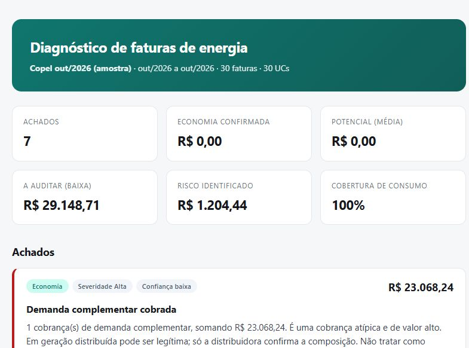

# Motor de Diagnóstico de Energia

[](https://github.com/augusto10vellozo-coder/motor-diagnostico-energia/actions/workflows/ci.yml)

Motor de regras independente do painel. Recebe faturas normalizadas e devolve **achados priorizados, com evidência e confiança** — não só um dashboard.

Ele existe para virar produto: o mesmo motor roda para uma agroindústria, para um cliente novo ou para uma consultoria parceira. Nenhum caminho, nome de UC ou layout está embutido.

## Por que separar

No painel atual o diagnóstico está espalhado: `flags()` no importador, cálculo no HTML, nomes de UC no `gerar-dados-cubi.cjs`. Isso funciona para um cliente e não escala.

Aqui a separação é explícita:

```
entrada (JSON/CSV)  →  normalize  →  engine (regras)  →  relatório (json/md/html)
                                        ↑
                              regras não sabem de onde veio o dado
```

- **Adaptador** (`src/normalize.cjs`): cada formato vira o modelo canônico.
- **Regra** (`src/rules/*.cjs`): recebe o contexto, devolve achados. Não lê arquivo, não conhece cliente.
- **Relatório** (`src/report.cjs`): formata. Não decide nada.

## Como rodar

```bash
# CSV de qualquer cliente (colunas aceitas: mes, uc, propriedade, valor, kwh, injetada, motivos)
node cli.cjs --input faturas.csv --cliente "Cliente X" --out saida

# JSON no modelo canônico
node cli.cjs --input dados.json --cliente "Cliente X" --out saida

# ajustar a tarifa de referência usada nas estimativas (R$/kWh)
node cli.cjs --input dados.json --tarifa-kwh 0.62

# teste
node test/run.cjs
```

Saídas em `saida/`: `<cliente>-diagnostico.json`, `.md` e `.html` (abre offline, imprime).

## Exemplo de saída



Relatório gerado a partir de uma amostra fictícia de 30 faturas da Copel: cada achado traz
categoria, severidade, confiança, valor estimado e a evidência que o sustenta. O HTML abre
offline e foi feito para impressão.

## Fluxo completo: PDF → diagnóstico

```bash
# 1. extrai os PDFs para JSON, com os itens linha a linha
node extrair.cjs --pasta "C:\...\Faturas\2026\10\COPEL" --out saida/copel-2026-10.json

# 2. roda o motor em cima do JSON extraído
node cli.cjs --input saida/copel-2026-10.json --cliente "Cliente X" --out saida
```

O extrator lê as **coordenadas x/y** do PDF e reconstrói a tabela por linha (a ordem do texto achatado embaralha as colunas em parte das faturas). Cada item vira:

```js
{ descricao, unidade, quantidade, valor_unitario, valor, tipo, posto }
```

Ele valida a soma dos itens contra o total da fatura. Se não fechar, marca `extracao.confiavel: false` e a fatura **fica fora** do diagnóstico de demanda — o motor não inventa número em cima de extração quebrada.

### Cobertura do extrator Copel (out/2026)

| Situação | Quantidade |
|---|---|
| PDFs na pasta | 145 |
| Com texto nativo | 30 |
| Extraídas e reconciliadas | **29 de 30** |
| Digitalizadas ou print de e-mail (precisam de OCR) | 89 |
| Protegidas por senha | 4 |

As 89 digitalizadas são o próximo gargalo: o extrator só lê PDF nativo. Para elas, o caminho é OCR da tabela (o projeto de faturas já tem Tesseract para os campos simples).

## Modelo canônico

```js
{
  distribuidora, uc, propriedade, competencia, vencimento, emissao,
  valor, kwh, injetada,
  motivos: [],   // ['multa por atraso', 'reativo excedente', ...]
  itens: [],     // [{ descricao, quantidade, unidade, valor }]
  status, fonte
}
```

Aceita apelidos nos campos (`mes`, `d`, `p`, `val`, `s`, `v`…), então o JSON do painel entra sem conversão manual.

## Regras atuais

| Regra | O que encontra | Precisa de | Confiança |
|---|---|---|---|
| `encargos` | multa, juros, bandeira | `motivos` | alta |
| `reativo` | reativo excedente recorrente | `motivos` | alta |
| `tarifa` | custo/kWh fora do padrão da própria UC | `kwh`, `valor` | baixa (proxy) |
| `consumo` | consumo fora do padrão da própria UC | `kwh`, `valor` | média |
| `solar` | geração injetada sem redução aparente | `injetada`, `kwh`, `valor` | baixa |
| `demanda` | ultrapassagem, demanda complementar, demanda superdimensionada | `itens` | alta / baixa |
| `integridade` | duplicidade, pendência, vencimento, sem consumo, extração quebrada | — | alta |

### Por que `tarifa` compara a UC com ela mesma

R$/kWh entre UCs diferentes não é comparável: a fatura inclui demanda contratada, iluminação pública e tributos. Uma granja em MT paga R$ 12/kWh e uma casa em BT R$ 0,70/kWh sem erro nenhum. Na primeira calibração, a comparação entre pares gerou R$ 2,5 mi de "economia" — falso.

A comparação válida é a UC com o próprio histórico. Mesmo assim o número é proxy, então entra em **"a auditar"**, não em economia confirmada.

### Três caixas de valor

O resumo separa o que é defensável do que é pista:

- **Confirmada** — confiança alta (ex.: multa, duplicidade, ultrapassagem).
- **Potencial** — confiança média (ex.: consumo fora do padrão).
- **A auditar** — confiança baixa (ex.: custo/kWh, solar).

Isso evita a pior coisa que um diagnóstico pode fazer: prometer economia que não se confirma na fatura.

## Como adicionar uma regra

1. Crie `src/rules/minha-regra.cjs`:

```js
const { achado } = require('../finding.cjs');

module.exports = {
  id: 'minha-regra',
  nome: 'Nome legível',
  categoria: 'economia',      // economia | risco | qualidade | informativo
  requer: ['kwh'],            // o motor pula sozinho se faltar dado
  avaliar(ctx) {
    return [achado({
      severidade: 'media',
      confianca: 'media',
      titulo: '...',
      descricao: '...',
      valor_estimado: 123.45,
      evidencias: [{ uc, propriedade, competencia, texto }],
      recomendacao: '...',
    })];
  },
};
```

2. Registre em `src/rules/index.cjs`.
3. Adicione um caso em `test/run.cjs`.

O motor trata `requer`, erro e ordenação. A regra só decide o que é achado.

## Próximos passos do extrator

1. **OCR das 89 digitalizadas** — hoje elas ficam de fora. O projeto de faturas já usa Tesseract; falta aplicar na tabela de itens.
2. **Créditos de fatura anterior em página separada** — algumas distribuidoras trazem `SALDO DE CREDITOS` e `DEV.CORR. MONETARIA` fora da tabela principal; a extração não fecha e por isso a fatura é marcada como não confiável.
3. **Celesc e Equatorial** — mesma interface (`detectar`, `extrairDoPdf`), parser próprio.
4. **Enquadramento tarifário** — comparar modalidade (convencional, branca, verde, azul) com o perfil de consumo. Ainda depende de mais campos da fatura.

## Privacidade

Os relatórios gerados com dados reais contêm nome de propriedade, UC e nota fiscal. **Este
repositório não inclui dados de cliente nem PDFs** (`saida/` está no `.gitignore`). Para
demonstração, use base anonimizada ou um CSV próprio.

## Testes

```bash
node test/run.cjs
```

O teste cobre normalização, as 7 regras e o formato do relatório. Rode antes de abrir PR.

